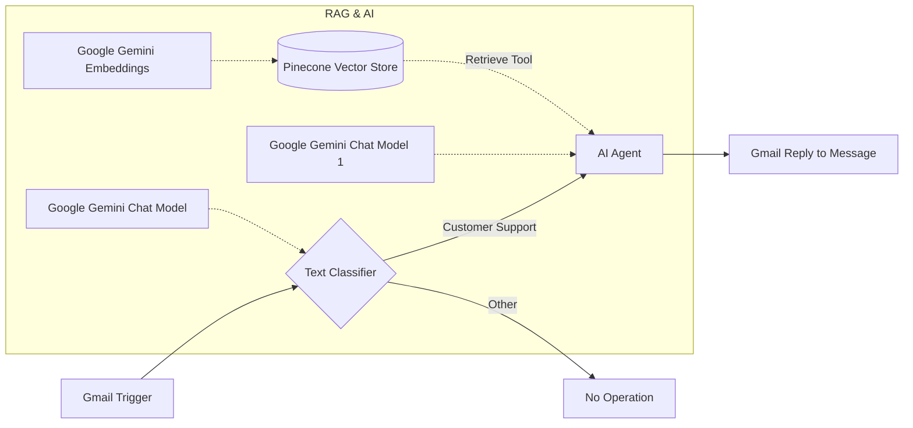

# Customer Support RAG Workflow (n8n)

An intelligent, automated customer support email responder built with **n8n**, **Google Gemini**, **Pinecone Vector Database**, and **Gmail**.

---

## 🚀 Overview

This workflow monitors incoming customer emails via Gmail, classifies the intent, retrieves relevant policies and FAQs using Retrieval-Augmented Generation (RAG) powered by Pinecone, and automatically crafts a friendly, contextual response signed off on behalf of the support team.

---

## 🛠️ Architecture & Workflow



### Steps:
1. **Gmail Trigger**: Polls every minute for new incoming customer emails.
2. **Text Classifier**: Classifies incoming email content into:
   - `customer support`: Inquiries regarding policies, products, or services.
   - `other`: Non-support emails (routed to a `No Operation` node).
3. **AI Agent (RAG)**:
   - Powered by **Google Gemini**.
   - Connected to **Pinecone Vector Store** (`FAQ` namespace) with **Gemini Embeddings** as a retrieval tool.
   - Grounded responses using policies and FAQs stored in your vector database.
4. **Gmail Reply**: Automatically sends back the generated response as an in-thread email reply.

---

## 📦 How to Import into n8n

1. Download or clone this repository:
   ```bash
   git clone https://github.com/rohnit20/CustomerSupportRAGn8n.git
   ```
2. In your **n8n** instance:
   - Click **Workflows** > **Add Workflow** (`+`).
   - Click the **three dots (`...`)** in the upper right corner > **Import from File**.
   - Select [`Customer_Support_Workflow.json`](./Customer_Support_Workflow.json).
3. Re-attach credentials:
   - **Gmail OAuth2**
   - **Google Gemini API** (PaLM / Gemini API key)
   - **Pinecone API** (Index name & API key)
4. Activate the workflow!

---

## 📄 License
MIT License
